# ZeroLink Architecture & Protocol Specification
**Codename:** `zerolink-core`  
**Revision:** 1.0.0 (Production Blueprint)

---

## 1. Executive Summary & Design Targets

ZeroLink is an ultra-low-power, zero-overhead device integration fabric between Android and Microsoft Windows. Unlike legacy bridges (e.g. Microsoft Phone Link, KDE Connect) that rely on persistent Wi-Fi TCP sockets, heavy background runtimes, Electron wrappers, and high polling rates, ZeroLink is architected around:

1. **Dual-Radio State Machine:** BLE L2CAP CoC or the paired TCP bridge carries control and small payloads; an on-demand Wi-Fi TCP socket carries photo ranges. The bulk socket uses challenge-bound AES-GCM keys derived from a one-time token delivered over the paired encrypted channel.
2. **Zero-Copy Memory Model:** Rust core paired with FlatBuffers binary serialization. Eliminates JSON deserialization overhead, GC pauses, and heap allocations in hot paths.
3. **Native OS Surface:** Windows daemon operates via raw Win32 message pumps (`WM_CLIPBOARDUPDATE`), WinRT `ToastNotificationManager`, and the Windows Cloud Filter API (`cldapi.dll`). Android layer operates via event-driven `NotificationListenerService`, native JNI bindings, and hardware `MediaCodec`.

### Design Targets (Not Independently Reproduced in This Review)
| Metric | Target | Design Mechanism |
| :--- | :--- | :--- |
| **Android Battery Drain** | 1.0% – 2.0% / 24h (5000 mAh) | Zero wake locks; radio sleeps in Doze mode; L2CAP interrupt-driven |
| **Android Power Budget** | < 100 mAh / day | BLE CoC slave latency = 45–60 intervals; radio duty cycle < 0.2% |
| **Windows RAM Footprint**| Target < 15 MB working set | No CEF/WebView runtime; three isolated 8-second no-peer idle snapshots from `scripts/measure_zerolink_memory.ps1` after the delayed startup trim measured 14.25–14.26 MB working set and 3.11–3.35 MB private memory. Connected-session and Android Doze measurements remain open. |
| **Windows Idle CPU** | 0.0% – 0.1% | `GetMessageW` on hidden message-only window; zero polling timers |
| **Screen Mirror Latency**| < 35 ms end-to-end | Hardware H.265/HEVC encode/decode with dynamic 0–60 FPS throttling |

---

## 2. Directory Structure

```plaintext
zerolink/
├── ARCHITECTURE.md                 # Complete blueprint & protocol definitions
├── Cargo.toml                      # Workspace manifest
├── schemas/
│   └── zerolink.fbs                # FlatBuffers zero-copy serialization schema
├── zerolink-core/                  # Shared Rust crate (crypto, framing, parsers)
│   ├── Cargo.toml
│   └── src/
│       ├── lib.rs
│       ├── crypto.rs               # X25519 ECDH, HKDF-SHA256, AES-256-GCM
│       ├── framing.rs              # Length-prefixed framed stream, CRC32
│       ├── protocol.rs             # Protocol payload structures & serialization
│       ├── state_machine.rs        # Dual-Radio State Machine
│       └── error.rs
├── zerolink-android/               # Kotlin Android Service + Rust JNI bindings
│   ├── app/
│   │   ├── build.gradle.kts
│   │   └── src/main/
│   │       ├── AndroidManifest.xml
│   │       ├── java/org/zerolink/
│   │       │   ├── ZeroLinkService.kt
│   │       │   ├── ble/L2capServer.kt
│   │       │   ├── notifications/ZeroNotificationListener.kt
│   │       │   ├── clipboard/ZeroClipboardManager.kt
│   │       │   ├── wifi/EphemeralWifiManager.kt
│   │       │   ├── media/H265ScreenEncoder.kt
│   │       │   └── jni/ZeroLinkNative.kt
│   │       └── res/
│   ├── zerolink-jni/               # Rust cdylib providing JNI bindings
│   │   ├── Cargo.toml
│   │   └── src/lib.rs
│   ├── build.gradle.kts
│   └── settings.gradle.kts
└── zerolink-win/                   # Rust Windows Daemon + Win32/cldapi integrations
    ├── Cargo.toml
    └── src/
        ├── main.rs                 # Win32 service entrypoint & message loop
        ├── ble_client.rs           # Windows.Devices.Bluetooth L2CAP client
        ├── clipboard.rs            # WM_CLIPBOARDUPDATE listener & injector
        ├── notifications.rs        # Native WinRT Toast notifications
        ├── cloud_filter.rs         # Cloud Filter API (cldapi.dll) virtual drive
        ├── bulk_client.rs          # Ephemeral encrypted TCP client for photo ranges
        ├── hevc_decoder.rs         # D3D11-aware async Media Foundation decode + software fallback
        ├── d3d_presenter.rs        # D3D11 NV12 video processing and swap-chain presentation
        └── screen_viewer.rs        # Native D3D11/GDI frame viewer and normalized remote input window
```

---

## 3. Dual-Radio State Machine & Handshake Protocol

```mermaid
stateDiagram-v2
    [*] --> Standby_Disconnected

    state BLE_Low_Power_Domain {
        Standby_Disconnected --> BLE_Advertising: Android starts advertising
        BLE_Advertising --> BLE_Connected_L2CAP: Windows initiates L2CAP CoC connection
        BLE_Connected_L2CAP --> ECDH_Handshake: Exchange ephemeral public keys
        ECDH_Handshake --> Pairing_Approval: New peer; compare code and approve both sides
        Pairing_Approval --> Authenticated_Session: Encrypted pairing acknowledgement
        ECDH_Handshake --> Authenticated_Session: Existing PSK proofs verified
        Authenticated_Session --> Idle_Low_Power: Session is ready for data
        Idle_Low_Power --> Signaling_Event: Clip update / Notification
        Signaling_Event --> Idle_Low_Power: Ack received
    }

    state Ephemeral_WiFi_Domain {
        Idle_Low_Power --> WiFi_Waking: BLE Magic Packet "WAKE_WIFI"
        WiFi_Waking --> WiFi_Direct_Established: Ephemeral local TCP socket (challenge-bound AES-GCM)
        WiFi_Direct_Established --> Bulk_Data_Transfer: Stream photo/file chunks or H.265
        Bulk_Data_Transfer --> WiFi_Teardown: Transfer complete or session exit
        WiFi_Teardown --> Idle_Low_Power: Restore Wi-Fi to its prior state
    }
```



### 3.1 ECDH Secure Handshake (Curve25519 + HKDF + AES-256-GCM)
1. **Key Generation:** Both Windows client and Android host generate an ephemeral X25519 keypair ($sk_w, pk_w$) and ($sk_a, pk_a$).
2. **Key Exchange (Framed L2CAP packet):**
   - Windows sends `HandshakeInit { client_ephemeral_pubkey, salt, protocol_version: 3, client_device_name, pairing_auth_tag }`. The tag is zero for a new pairing; otherwise it is a role-labeled HMAC under the saved pairing secret.
   - Android validates the client proof when paired, computes shared secret $S = \text{X25519}(sk_a, pk_w)$, and returns `HandshakeReply { server_ephemeral_pubkey, auth_tag, l2cap_psm, server_device_name, pairing_auth_tag }`. Both parsers reject truncated and trailing handshake bytes.
   - Windows verifies Android's transcript confirmation and stored-secret proof. On first pairing, both devices show the same six-digit code and require local approval. Windows then sends its reciprocal key-confirmation frame containing marker `0x02` and a 16-byte transcript tag.
3. **Session Key Derivation:** HKDF-SHA256 with info `ZeroLink-v3-AEAD-Session-Keys` derives 152 bytes: initiator AES key (32), initiator nonce base (12), responder AES key (32), responder nonce base (12), confirmation key (32), and first-pairing secret (32). Separate directional keys and nonce bases prevent nonce reuse across peers.
4. **Pairing commit and reconnect:** After confirming Windows' key proof, Android stores the new secret using an Android Keystore AES-GCM wrapping key and sends encrypted `Signaling` payload `50 01`. Windows stores it using current-user DPAPI after receiving that marker. Feature packets remain gated until that acknowledgement is received. Returning peers prove possession in both handshake messages; one-sided or mismatched state is rejected without downgrade.
5. **Key confirmation and counter nonce:** Each side computes the first 16 bytes of HMAC-SHA256 over a role-specific label (`ZeroLink-v3-server-key-confirmation` or `ZeroLink-v3-client-key-confirmation`) and `client_pubkey || salt || server_pubkey`. Directional sequence counters are authenticated and replayed values are rejected.

---

## 4. BLE L2CAP Connection-Oriented Channels (CoC)

Standard BLE GATT imposes high overhead: 3-byte ATT header per 20–244 byte MTU, attribute table queries, and connection interval negotiations for every write.

ZeroLink bypasses GATT for data exchange, utilizing **BLE L2CAP CoC** directly:
- **PSM (Protocol/Service Multiplexer):** Android obtains the L2CAP CoC PSM from the OS at runtime, advertises it in ZeroLink BLE service data, and includes it in the handshake reply. Windows uses `0x1001` only as a compatibility fallback when an older advertisement omits the PSM.
- **L2CAP MTU:** Negotiated up to 65535 bytes (standard operational MTU = 2048 bytes).
- **Zero Polling:** Uses Bluetooth hardware interrupt triggers.
- **Connection Parameters:**
  - `Connection Interval`: 45 ms – 60 ms
  - `Slave Latency`: 4 (Android can skip up to 4 intervals when idle without disconnecting)
  - `Supervision Timeout`: 5000 ms
  - Average idle draw: **< 1.8 mA**, ensuring Android Doze Mode remains uncompromised.

---

## 5. Zero-Copy Packet Framing

Every framed control packet transmitted over L2CAP or the primary TCP bridge adheres to a fixed 20-byte header followed by AES-GCM ciphertext and authentication tag (the 12-byte nonce is derived deterministically from the 8-byte sequence number XORed with the session IV base, requiring zero wire overhead). The separate bulk TCP socket uses fresh challenge-derived directional keys and AES-GCM for its single encrypted request and response; it does not use this frame header.

```
+---------------+---------------+---------------+---------------+
| Magic (2B)    | Version (1B)  | PacketType(1B)| PayloadLen(4B)|
| 0x5A 0x4C     | 0x01          | (Enum)        | Big-Endian u32|
+---------------+---------------+---------------+---------------+
| Sequence Number (8B)                                          |
| Big-Endian u64 (Monotonic anti-replay counter)                |
+---------------------------------------------------------------+
| CRC32 Header Checksum (4B)                                    |
| IEEE 802.3 over bytes 0..16                                   |
+---------------------------------------------------------------+
| Encrypted Payload (Variable: PayloadLen bytes = Ciphertext)   |
+---------------------------------------------------------------+
| GCM Tag (16B appended to Ciphertext)                          |
+---------------------------------------------------------------+
```

### 5.1 Packet Types

| Type | Value | Direction | Payload |
| :--- | :--- | :--- | :--- |
| `Handshake` | `0x01` | Bidirectional | X25519 pubkey, salt / reply + auth tag |
| `Signaling` | `0x02` | Bidirectional | Session control |
| `Notification` | `0x03` | Android → Windows | `NotificationPayload` |
| `Clipboard` | `0x04` | Bidirectional | `ClipboardPayload` (format, SipHash, timestamp, bytes) |
| `FileMetadata` | `0x05` | Android → Windows | `FileCatalog` / `FileMetadata` |
| `FileChunk` | `0x06` | Android → Windows | `FileFetchChunk` |
| `WifiWake` | `0x07` | Bidirectional | `WifiWakePayload` |
| `ScreenCast` | `0x08` | Android → Windows | `VideoFrameHeader` + HEVC NAL units |
| `Heartbeat` | `0x09` | Android → Windows | Battery, charging, Wi-Fi, bulk TCP port, power mode |
| `KeepAlive` | `0x0A` | Bidirectional | Empty |
| `NotificationAction` | `0x0B` | Windows → Android | `NotificationActionPayload` (notification id, action id, reply text) |
| `MediaControl` | `0x0C` | Android → Windows | `MediaControlPayload` (1-byte command) |
| `ScreenInput` | `0x0D` | Windows → Android | `ScreenInputPayload` (normalized x/y, action, wheel delta) |
| `MediaState` | `0x0E` | Windows → Android | `MediaStatePayload` (title, artist, album, app, playback, timeline) |

---

## 6. Windows Daemon & Native Win32 Subsystems

### 6.1 Win32 Clipboard Hook (`WM_CLIPBOARDUPDATE`)
- Creates a hidden window using `RegisterClassExW` and `CreateWindowExW(HWND_MESSAGE)`.
- Calls `AddClipboardFormatListener(hwnd)`.
- The Windows OS directly sends `WM_CLIPBOARDUPDATE` messages to the message queue.
- When invoked:
  1. Open clipboard via `OpenClipboard(hwnd)`.
  2. Inspect format (`CF_UNICODETEXT`, `CF_DIBV5`).
  3. Hash payload (SipHash-2-4); if unchanged from last received remote sync, ignore to prevent reflection loops.
  4. If new, pack FlatBuffers `ClipboardPayload` and send across L2CAP CoC.
  5. Close clipboard immediately. CPU consumption: **0.0%**.

### 6.2 Native Windows Toasts (`Windows.UI.Notifications`)
- No Electron, no web views.
- Daemon invokes WinRT `ToastNotificationManager::CreateToastNotifierWithId` and constructs XML toast elements via native COM vtables.
- Supports inline dismiss and reply buttons; reply actions are piped back to the Android daemon over L2CAP to trigger `RemoteInput` pending intents.
- **Toast retention:** the daemon keeps up to 32 live `ToastNotification` objects (and their `Activated` handlers) so WinRT can deliver activation events. The previous fire-and-forget implementation could never receive inline replies.
- **Activation model:** activation is handled in-process while the resident daemon is running. True background activation (daemon stopped) would additionally require a COM `INotificationActivationCallback` implementation registered with an AUMID Start Menu shortcut.
- Toast arguments use the form `action=reply|dismiss&id=<notification key>` with percent-encoding; the reply text is read from the `quickReply` input of `ToastNotificationActivatedEventArgs.UserInput`.

### 6.3 Cloud Filter API (`cldapi.dll`) Virtual File System
- Android photos from DCIM / Screenshots are exposed as a virtual sync root using Windows Cloud Files API (`CfRegisterSyncRoot`).
- Photo metadata is synchronized over the paired transport (file IDs, relative names, sizes, and modified dates).
- Files appear in Windows File Explorer as 0-byte placeholders with `FILE_ATTRIBUTE_RECALL_ON_DATA_ACCESS`.
- When the user opens or double-clicks a photo:
  1. Windows filesystem filter driver intercepts the read and invokes `CF_CALLBACK_TYPE_FETCH_DATA`.
  2. ZeroLink daemon sends `WifiWake` and a random one-time token through the encrypted paired channel.
  3. Android starts a temporary TCP listener and sends a fresh challenge to the Windows client.
  4. Both sides derive separate AES-GCM request/response keys from the token and challenge. The token itself is never sent on the TCP socket; the request and returned byte range are authenticated and encrypted.
  5. Windows completes the pending range through `CfExecute(CF_OPERATION_TYPE_TRANSFER_DATA)`.
  6. The temporary listener closes after inactivity; Android restores Wi-Fi to its previous state.
- **Validation status:** source and build checks cover the transfer path, but reading a real photo placeholder and measuring throughput still require an Android/Windows device pair.

### 6.4 Media Playback Control (GSMTC)
- `windows::Media::Control::GlobalSystemMediaTransportControlsSessionManager` provides the active session.
- `query_state()` reads title, artist, album, source app AUMID, playback status, and timeline position/duration.
- Commands: Play, Pause, Toggle, Next, Previous, Volume Up/Down (volume falls back to multimedia `keybd_event` because GSMTC has no volume API).
- State is queried on demand: piggybacked on the existing 10-second Android heartbeat and immediately after every remote command. No dedicated polling timer is created, preserving the 0.0% idle CPU target.
- Android renders the state in a MainActivity card and in the ongoing notification (Prev / Play-Pause / Next actions via `MediaControlReceiver`).

---

## 7. Android Event-Driven Subsystems & Doze Optimization

### 7.1 Notification Listener Service
- Inherits `NotificationListenerService`.
- On `onNotificationPosted(sbn: StatusBarNotification)`:
  - Extracts title, text, app package, large icon bitmap (downsampled to 96x96 WebP).
  - Serializes to FlatBuffers `NotificationEvent`.
  - Pushes to native L2CAP buffer through JNI without Kotlin string allocation.
- **Inline reply actions:** the listener inspects `Notification.Action.remoteInputs` and caches the originating `PendingIntent` plus the `RemoteInput[]` descriptors in a bounded 32-entry LRU (`NotificationActionCache`), keyed by `StatusBarNotification.key`.
- When Windows sends `NotificationAction` (`0x0B`), the service calls `RemoteInput.addResultsToIntent()` with the typed text and fires the cached `PendingIntent`. A `dismiss` action instead invokes `NotificationListenerService.cancelNotification(key)`.
- Entries are evicted on `onNotificationRemoved`, on `PendingIntent.CanceledException`, and when the service is destroyed.

### 7.2 Zero-Root Background Clipboard Sync (Triple Guard)
- Android 10+ blocks background apps from reading `ClipboardManager` without window focus.
- ZeroLink implements a **Triple-Guard Zero-Root System**:
  1. **Accessibility Service (`ZeroAccessibilityService`)** — official Android framework, `canRetrieveWindowContent="false"` so window content is never inspected. Clipboard reads occur only after user interaction events (click, text selection, window change). The same service optionally provides rootless gesture injection (`canPerformGestures="true"`) for `ScreenInput`.
  2. **Notification quick action** — `[ 📋 Sync Clipboard ]` in the persistent foreground notification for one-tap sync from any app.
  3. **Quick Settings tile** — `ZeroClipboardTileService` for one-tap sync from the notification panel.
- **Anti-echo hashing:** SHA-256/SipHash comparisons prevent remote sync feedback loops.
- Push from Windows to Android uses `ClipboardManager.setPrimaryClip` from the foreground service, so no accessibility permission is required for that direction.

### 7.3 MediaProjection & H.265 Dynamic FPS Mirroring
- Android captures a `MediaProjection` virtual display into a `MediaCodec` HEVC encoder. It prefers a codec input surface and falls back to `ImageReader` flexible-YUV input where advertised; capability discovery runs off the UI thread.
- The service currently requests a 4 Mbps bitrate and 30 FPS. Actual codec, frame pacing, and power use depend on the device.
- There is no separate frame analyzer or damage-rectangle throttler in the current source. Encoded buffers are forwarded with PTS, keyframe state, and the active width/height.
- Android registers a `MediaProjection.Callback` before creating the virtual display. Android 14+ uses its captured-content resize callback; Android 10–13 use a default-display listener. Both resize the existing virtual display and recreate the encoder.
- HEVC packets are forwarded over ZeroLink's transport. Windows prefers an asynchronous D3D11-aware Media Foundation hardware MFT. When available, DXGI NV12 decoder surfaces go directly to a D3D11 video processor and swap chain for aspect-fit presentation. Unsupported surfaces or unavailable D3D presentation fall back to staging-texture readback, CPU BGRA conversion, and GDI; a synchronous software MFT is also retained as a decoder fallback.

> **Implementation status (current):** Android MediaCodec H.265 encoding and packetized transport are implemented, including surface-first and flexible-YUV input selection. The API 36 emulator accepted capture consent and foreground-service promotion but exposed no HEVC size/rate combination for `1080x2209` or tested lower sizes; it emitted no frames. The 27-byte `VideoFrameHeader` includes encoder width and height; Windows uses that aspect ratio to normalize mouse input. Windows prefers asynchronous D3D11-aware Media Foundation decoding and presents supported decoder surfaces directly through D3D11, with CPU/GDI and synchronous software-decoder fallbacks. Android 14+ uses MediaProjection captured-content resize callbacks, while Android 10–13 use a default-display listener; both resize the existing virtual display and restart the encoder. Supported-device playback, rotation, and Android gesture injection remain unverified.

---

## 8. Summary of Component Deliverables

1. `schemas/zerolink.fbs`: Zero-copy FlatBuffers definition.
2. `zerolink-core`: Rust crate with cryptographic primitives, framing, state machines.
3. `zerolink-win`: Rust Windows daemon with Win32 message loop, clipboard hooks, WinRT toasts, Cloud Filter placeholders.
4. `zerolink-android`: Gradle Kotlin project with JNI native Rust bindings, BLE L2CAP server, NotificationListener, Ephemeral Wi-Fi, and H.265 encoder.
