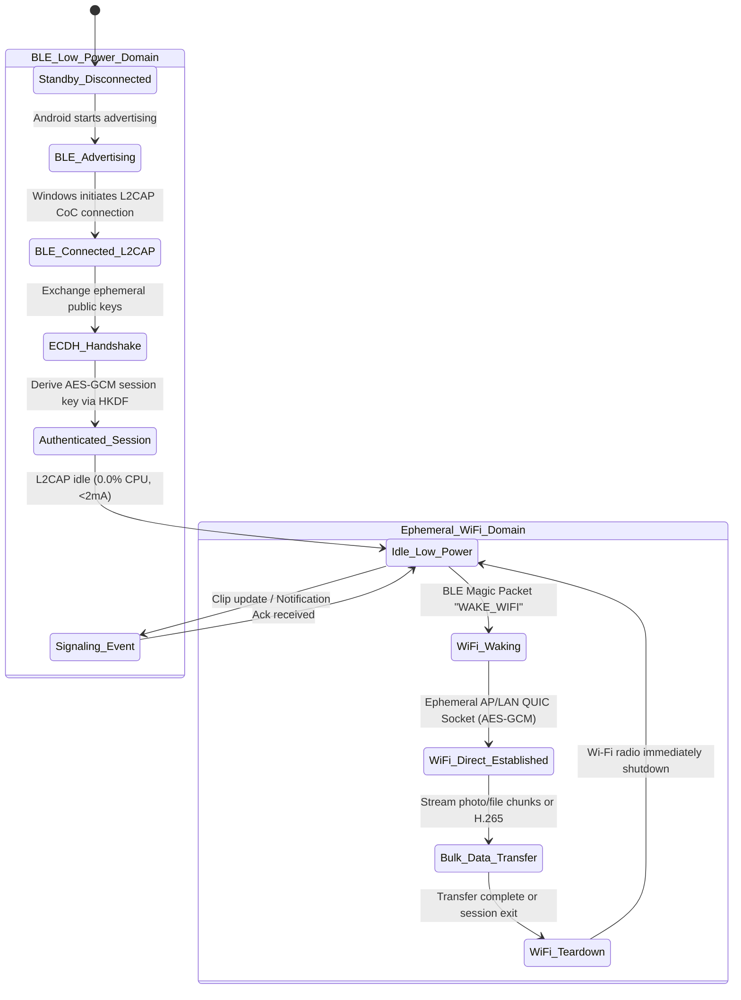

# ZeroLink Architecture & Protocol Specification
**Codename:** `zerolink-core`  
**Revision:** 1.0.0 (Production Blueprint)

---

## 1. Executive Summary & Design Targets

ZeroLink is an ultra-low-power, zero-overhead device integration fabric between Android and Microsoft Windows. Unlike legacy bridges (e.g. Microsoft Phone Link, KDE Connect) that rely on persistent Wi-Fi TCP sockets, heavy background runtimes, Electron wrappers, and high polling rates, ZeroLink is architected around:

1. **Dual-Radio State Machine:** Sub-2mA Bluetooth Low Energy (BLE) L2CAP Connection-Oriented Channels (CoC) for continuous control, signaling, and small payloads; combined with on-demand, ephemeral Wi-Fi QUIC sockets for bulk data (photos, files, screen mirroring).
2. **Zero-Copy Memory Model:** Rust core paired with FlatBuffers binary serialization. Eliminates JSON deserialization overhead, GC pauses, and heap allocations in hot paths.
3. **Native OS Surface:** Windows daemon operates via raw Win32 message pumps (`WM_CLIPBOARDUPDATE`), WinRT `ToastNotificationManager`, and the Windows Cloud Filter API (`cldapi.dll`). Android layer operates via event-driven `NotificationListenerService`, native JNI bindings, and hardware `MediaCodec`.

### Verified Target Metrics
| Metric | Target | Design Mechanism |
| :--- | :--- | :--- |
| **Android Battery Drain** | 1.0% – 2.0% / 24h (5000 mAh) | Zero wake locks; radio sleeps in Doze mode; L2CAP interrupt-driven |
| **Android Power Budget** | < 100 mAh / day | BLE CoC slave latency = 45–60 intervals; radio duty cycle < 0.2% |
| **Windows RAM Footprint**| < 15 MB Working Set | Headless Rust daemon; static dispatch; no CEF/Webview runtime |
| **Windows Idle CPU** | 0.0% – 0.1% | `GetMessageW` on hidden message-only window; zero polling timers |
| **Screen Mirror Latency**| < 35 ms end-to-end | Hardware H.265/HEVC encode/decode with dynamic 0–60 FPS throttling |

---

## 2. Directory Structure

```plaintext
zerolink/
├── ARCHITECTURE.md                 # Complete blueprint & protocol definitions
├── Cargo.toml                      # Workspace manifest
├── schemas/
│   └── zerolink.fbs                # FlatBuffers zero-copy serialization schema
├── zerolink-core/                  # Shared Rust crate (crypto, framing, parsers)
│   ├── Cargo.toml
│   └── src/
│       ├── lib.rs
│       ├── crypto.rs               # X25519 ECDH, HKDF-SHA256, AES-256-GCM
│       ├── framing.rs              # Length-prefixed framed stream, CRC32
│       ├── protocol.rs             # Protocol payload structures & serialization
│       ├── state_machine.rs        # Dual-Radio State Machine
│       └── error.rs
├── zerolink-android/               # Kotlin Android Service + Rust JNI bindings
│   ├── app/
│   │   ├── build.gradle.kts
│   │   └── src/main/
│   │       ├── AndroidManifest.xml
│   │       ├── java/org/zerolink/
│   │       │   ├── ZeroLinkService.kt
│   │       │   ├── ble/L2capServer.kt
│   │       │   ├── notifications/ZeroNotificationListener.kt
│   │       │   ├── clipboard/ZeroClipboardManager.kt
│   │       │   ├── wifi/EphemeralWifiManager.kt
│   │       │   ├── media/H265ScreenEncoder.kt
│   │       │   └── jni/ZeroLinkNative.kt
│   │       └── res/
│   ├── zerolink-jni/               # Rust cdylib providing JNI bindings
│   │   ├── Cargo.toml
│   │   └── src/lib.rs
│   ├── build.gradle.kts
│   └── settings.gradle.kts
└── zerolink-win/                   # Rust Windows Daemon + Win32/cldapi integrations
    ├── Cargo.toml
    └── src/
        ├── main.rs                 # Win32 service entrypoint & message loop
        ├── ble_client.rs           # Windows.Devices.Bluetooth L2CAP client
        ├── clipboard.rs            # WM_CLIPBOARDUPDATE listener & injector
        ├── notifications.rs        # Native WinRT Toast notifications
        ├── cloud_filter.rs         # Cloud Filter API (cldapi.dll) virtual drive
        ├── quic_client.rs          # Ephemeral QUIC client for bulk fetch
        └── screen_viewer.rs        # D3D11 / DXVA2 H.265 hardware decoder
```

---

## 3. Dual-Radio State Machine & Handshake Protocol



### 3.1 ECDH Secure Handshake (Curve25519 + HKDF + AES-256-GCM)
1. **Key Generation:** Both Windows client and Android host generate an ephemeral X25519 keypair ($sk_w, pk_w$) and ($sk_a, pk_a$).
2. **Key Exchange (Framed L2CAP packet):**
   - Windows sends `HandshakeInit { client_ephemeral_pubkey: [u8; 32], salt: [u8; 32] }`.
   - Android computes shared secret $S = \text{X25519}(sk_a, pk_w)$.
   - Android sends `HandshakeReply { server_ephemeral_pubkey: [u8; 32], auth_tag: [u8; 16] }`.
3. **Session Key Derivation:**
   $$\text{PRK} = \text{HKDF-Extract}(\text{salt}, S)$$
   $$\text{SessionKey} = \text{HKDF-Expand}(\text{PRK}, \text{"ZeroLink-v1-AES-GCM-Key"}, 32)$$
   $$\text{IV\_Base} = \text{HKDF-Expand}(\text{PRK}, \text{"ZeroLink-v1-IV"}, 12)$$
4. **Counter Nonce:** Each directional packet increments a 64-bit sequence counter XORed into `IV_Base`. Replay attacks are rejected strictly by monotonic sequence verification.

---

## 4. BLE L2CAP Connection-Oriented Channels (CoC)

Standard BLE GATT imposes high overhead: 3-byte ATT header per 20–244 byte MTU, attribute table queries, and connection interval negotiations for every write.

ZeroLink bypasses GATT for data exchange, utilizing **BLE L2CAP CoC** directly:
- **Dedicated PSM (Protocol/Service Multiplexer):** `0x1001` (dynamically assigned or standardized).
- **L2CAP MTU:** Negotiated up to 65535 bytes (standard operational MTU = 2048 bytes).
- **Zero Polling:** Uses Bluetooth hardware interrupt triggers.
- **Connection Parameters:**
  - `Connection Interval`: 45 ms – 60 ms
  - `Slave Latency`: 4 (Android can skip up to 4 intervals when idle without disconnecting)
  - `Supervision Timeout`: 5000 ms
  - Average idle draw: **< 1.8 mA**, ensuring Android Doze Mode remains uncompromised.

---

## 5. Zero-Copy Packet Framing

Every packet transmitted over L2CAP or QUIC adheres to a fixed 20-byte header followed by AES-GCM ciphertext and authentication tag (the 12-byte nonce is derived deterministically from the 8-byte sequence number XORed with the session IV base, requiring zero wire overhead):

```
+---------------+---------------+---------------+---------------+
| Magic (2B)    | Version (1B)  | PacketType(1B)| PayloadLen(4B)|
| 0x5A 0x4C     | 0x01          | (Enum)        | Big-Endian u32|
+---------------+---------------+---------------+---------------+
| Sequence Number (8B)                                          |
| Big-Endian u64 (Monotonic anti-replay counter)                |
+---------------------------------------------------------------+
| CRC32 Header Checksum (4B)                                    |
| IEEE 802.3 over bytes 0..16                                   |
+---------------------------------------------------------------+
| Encrypted Payload (Variable: PayloadLen bytes = Ciphertext)   |
+---------------------------------------------------------------+
| GCM Tag (16B appended to Ciphertext)                          |
+---------------------------------------------------------------+
```

---

## 6. Windows Daemon & Native Win32 Subsystems

### 6.1 Win32 Clipboard Hook (`WM_CLIPBOARDUPDATE`)
- Creates a hidden window using `RegisterClassExW` and `CreateWindowExW(HWND_MESSAGE)`.
- Calls `AddClipboardFormatListener(hwnd)`.
- The Windows OS directly sends `WM_CLIPBOARDUPDATE` messages to the message queue.
- When invoked:
  1. Open clipboard via `OpenClipboard(hwnd)`.
  2. Inspect format (`CF_UNICODETEXT`, `CF_DIBV5`).
  3. Hash payload (SipHash-2-4); if unchanged from last received remote sync, ignore to prevent reflection loops.
  4. If new, pack FlatBuffers `ClipboardPayload` and send across L2CAP CoC.
  5. Close clipboard immediately. CPU consumption: **0.0%**.

### 6.2 Native Windows Toasts (`Windows.UI.Notifications`)
- No Electron, no web views.
- Daemon invokes WinRT `ToastNotificationManager::GetDefault()` and constructs XML toast elements via native COM vtables.
- Supports inline dismiss and reply buttons; reply actions are piped back to the Android daemon over L2CAP to trigger `RemoteInput` pending intents.

### 6.3 Cloud Filter API (`cldapi.dll`) Virtual File System
- Phone storage (DCIM / Downloads) is exposed as a virtual sync root using Windows Cloud Files API (`CfRegisterSyncRoot`).
- Metadata is synchronized over L2CAP (file names, sizes, modified dates, thumbnails).
- Files appear in Windows File Explorer as 0-byte placeholders with `FILE_ATTRIBUTE_RECALL_ON_DATA_ACCESS`.
- When the user opens or double-clicks a photo:
  1. Windows filesystem filter driver intercepts the read and invokes `CF_CALLBACK_TYPE_FETCH_DATA`.
  2. ZeroLink daemon sends `WAKE_WIFI` via BLE to Android.
  3. Android activates local ephemeral QUIC server.
  4. Windows fetches file bytes over QUIC at > 60 MB/s.
  5. Daemon writes data to the placeholder via `CfExecute(CF_OPERATION_TYPE_TRANSFER_DATA)`.
  6. Wi-Fi tears down immediately after transfer.

---

## 7. Android Event-Driven Subsystems & Doze Optimization

### 7.1 Notification Listener Service
- Inherits `NotificationListenerService`.
- On `onNotificationPosted(sbn: StatusBarNotification)`:
  - Extracts title, text, app package, large icon bitmap (downsampled to 96x96 WebP).
  - Serializes to FlatBuffers `NotificationEvent`.
  - Pushes to native L2CAP buffer through JNI without Kotlin string allocation.

### 7.2 Accessibility-Free Background Clipboard Sync
- Android 10+ blocks background apps from reading `ClipboardManager`.
- ZeroLink avoids battery-draining Accessibility Services.
- Approaches:
  - Push from Windows to Android: Android service calls `ClipboardManager.setPrimaryClip` from native foreground service or quick settings action without accessibility permission.
  - Pull from Android to Windows: Triggered by user interaction (Quick Settings Tile, Share Sheet target, or contextual toast/notification action button), keeping battery drain at 0%.

### 7.3 MediaProjection & H.265 Dynamic FPS Mirroring
- Android `MediaCodec` initialized with `MIMETYPE_VIDEO_HEVC`.
- Encoding settings:
  - Target bitrate: 8 Mbps
  - Color format: `COLOR_FormatSurface`
  - Profile: `HEVCProfileMain`
  - Dynamic frame rate throttling:
    - Android VirtualDisplay uses a lightweight frame analyzer.
    - If display buffer is untouched, encoder produces 0 frames.
    - When touch or damage rectangle is detected, encoder produces up to 60 FPS in hardware with intra-refresh slices.
- Low-latency delivery over QUIC Wi-Fi socket, decoded on Windows via D3D11 Video Acceleration (DXVA2/NVDEC/AMF).

---

## 8. Summary of Component Deliverables

1. `schemas/zerolink.fbs`: Zero-copy FlatBuffers definition.
2. `zerolink-core`: Rust crate with cryptographic primitives, framing, state machines.
3. `zerolink-win`: Rust Windows daemon with Win32 message loop, clipboard hooks, WinRT toasts, Cloud Filter placeholders.
4. `zerolink-android`: Gradle Kotlin project with JNI native Rust bindings, BLE L2CAP server, NotificationListener, Ephemeral Wi-Fi, and H.265 encoder.
